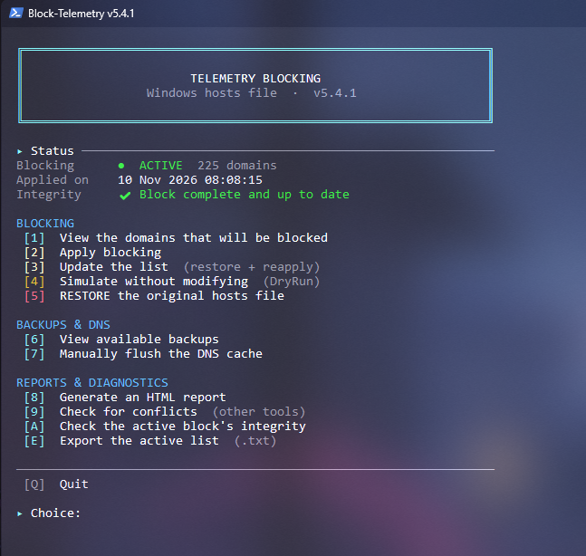
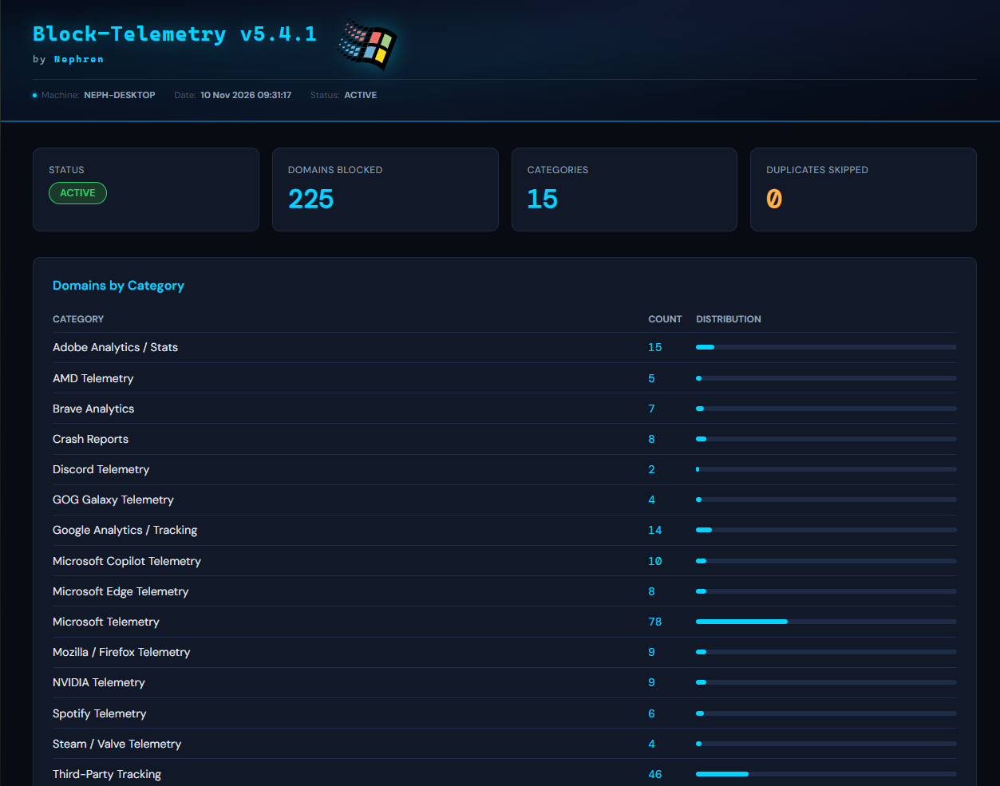
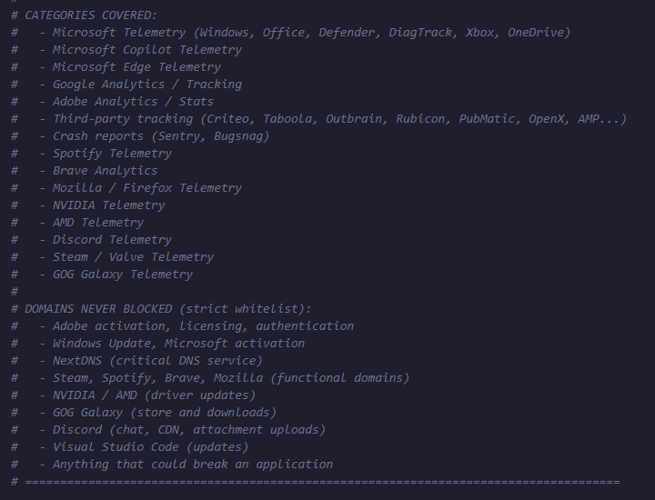

# Block-Telemetry

🇫🇷 [Version française](README_FRENCH.md)

Standalone PowerShell script that blocks telemetry, analytics, and third-party tracking domains on Windows via the `hosts` file — with automatic backups, a strict whitelist, a dry-run preview, one-click restore, and an integrity checker so the block never silently drifts out of sync.

> Nothing is guessed. A strict whitelist protects activation/licensing/update domains by exact match (never a substring match), every real change is backed up first, and the active block can be verified against the expected list at any time.

---

## Screenshots

<table>
<tr>
<td></td>
<td></td>
</tr>
</table>

More screenshots (integrity check, backups list, full HTML report) in the [`screenshots/`](screenshots) folder.

---

## Table of contents

- [Screenshots](#screenshots)
- [Overview](#overview)
- [How it works](#how-it-works)
- [What gets blocked](#what-gets-blocked)
- [What is never blocked (whitelist)](#what-is-never-blocked-whitelist)
- [Windows Defender cloud protection](#windows-defender-cloud-protection)
- [Safety guarantees](#safety-guarantees)
- [Prerequisites](#prerequisites)
- [First run](#first-run-step-by-step)
- [Menu reference](#menu-reference)
- [Command-line parameters](#command-line-parameters)
- [Files written by the script](#files-written-by-the-script)
- [Multi-machine deployment](#multi-machine-deployment)
- [Troubleshooting](#troubleshooting)

---

## Overview

`Block-Telemetry.ps1` edits **one file only**: the Windows `hosts` file (`C:\Windows\System32\drivers\etc\hosts`). It appends a clearly marked block of `0.0.0.0 <domain>` entries for known telemetry, analytics, and tracking domains, so that DNS resolution for those domains fails locally — no traffic reaches them.

It does **not** touch the registry, does not stop any Windows service, does not install anything, and does not modify any file other than `hosts` (plus its own backups/logs/reports in a `Maintenance_Reports\Block-Telemetry` folder on the Desktop).

The script runs as an **interactive menu** — there is no one-shot "just clean it" command line invocation for the blocking action itself (only `-SelfTest` is a pure CLI flag). This is intentional: modifying `hosts` is a standing change (unlike a one-off cleanup), so the script keeps a human in the loop for applying, updating, and restoring it.

---

## How it works

1. All changes live inside a single clearly delimited block in `hosts`:

   ```
   # === TELEMETRY BLOCK - Do not modify manually ===
   # Generated on 18 Aug 2026 10:00:00
   # To restore: rerun this script and choose option 5
   #
   # -- Microsoft Telemetry --
   0.0.0.0 vortex.data.microsoft.com
   0.0.0.0 telecommand.telemetry.microsoft.com
   ...
   # === END TELEMETRY BLOCK ===
   ```

   Everything outside these two markers is left completely untouched — your own manual `hosts` entries, entries from other tools, everything.

2. Before **any** write to `hosts`, a timestamped backup is created in the `Hosts_Backups` subfolder (see [Files written by the script](#files-written-by-the-script)). If the backup fails, the script refuses to modify `hosts` at all.

3. Domains already present anywhere in your `hosts` file (added manually or by another tool) are detected and skipped rather than duplicated.

4. Restoring removes **only** the content between the two markers — your original `hosts` file (and anything else added since) is preserved exactly as it was outside that block.

---

## What gets blocked

15 categories, **225 domains** in total:



<details>
<summary><strong>Microsoft Telemetry</strong> — 78 domains</summary>

Windows diagnostic data (DiagTrack / vortex / watson pipelines), Office/ARIA telemetry pipeline, old MAPS/"SpyNet" Defender hostnames (`spynet*`, kept blocked but unverified — see the script comments), the Windows Live/OneDrive endpoint `ssw.live.com`, MSN/Cortana/Bing ad and suggestion endpoints, Xbox/Game Bar telemetry, OneDrive telemetry (not sync), Teams telemetry (not communication).

*Excluded on purpose:* `windowsupdate.com`, `update.microsoft.com`, `msftconnecttest.com` (required for updates and connectivity detection), and `wdcp.microsoft.com` / `wdcpalt.microsoft.com` (Microsoft Defender cloud-delivered protection — see [Windows Defender cloud protection](#windows-defender-cloud-protection)).
</details>

<details>
<summary><strong>Microsoft Copilot Telemetry</strong> — 10 domains</summary>

Usage data, query and context telemetry sent to Microsoft/Bing servers. Copilot itself is not blocked functionally on machines that use it — only the analytics endpoints.
</details>

<details>
<summary><strong>Microsoft Edge Telemetry</strong> — 8 domains</summary>

Relevant even if Edge is uninstalled — WebView2 and Edge leftovers can still reach these endpoints.
</details>

<details>
<summary><strong>Google Analytics / Tracking</strong> — 14 domains</summary>

Google Analytics, Tag Manager, DoubleClick, Google Ad Services.

*Excluded on purpose:* `google.com`, `googleapis.com`, `gstatic.com` (required by many web apps and authentication flows).
</details>

<details>
<summary><strong>Adobe Analytics / Stats</strong> — 15 domains</summary>

Adobe Analytics/Omniture, Adobe Audience Manager, Adobe Dynamic Tag Manager, Adobe Marketing/Advertising Cloud.

*Excluded on purpose:* `adobe.com`, `adobelogin.com`, `adobegenuine.com`, `lcs-cops.adobe.com` (activation, licensing, functional endpoints).
</details>

<details>
<summary><strong>Third-party tracking</strong> — 46 domains</summary>

None of these belong to a locally installed app — they're only loaded by websites or apps to track you across sessions: ScorecardResearch, Quantcast, Chartbeat, Facebook/Meta tracking, Amazon Ads, Twitter/X Ads, Hotjar, Mixpanel, Segment, Criteo, Taboola, Outbrain, Rubicon/Magnite, PubMatic, OpenX, Moat, Google AMP, LinkedIn Insight Tag.
</details>

<details>
<summary><strong>Crash reports</strong> — 8 domains</summary>

Sentry.io, Bugsnag — send stack traces and system data on app crashes. Informative but intrusive; note this can reduce the quality of app bug fixes since developers lose that diagnostic data.
</details>

<details>
<summary><strong>Spotify Telemetry</strong> — 6 domains</summary>

*Excluded on purpose:* `*.spotify.com` (streaming, login, API), `*.scdn.co` (music CDN), `accounts.spotify.com`, `api.spotify.com`.
</details>

<details>
<summary><strong>Brave Analytics</strong> — 7 domains</summary>
</details>

<details>
<summary><strong>Mozilla / Firefox Telemetry</strong> — 9 domains</summary>
</details>

<details>
<summary><strong>NVIDIA Telemetry</strong> — 9 domains</summary>
</details>

<details>
<summary><strong>AMD Telemetry</strong> — 5 domains</summary>
</details>

<details>
<summary><strong>Discord Telemetry</strong> — 2 domains</summary>
</details>

<details>
<summary><strong>Steam / Valve Telemetry</strong> — 4 domains</summary>
</details>

<details>
<summary><strong>GOG Galaxy Telemetry</strong> — 4 domains</summary>
</details>

Use menu option **[1]** at any time to print the complete, current list grouped by category, or **[E]** to export it to a text file.

---

## What is never blocked (whitelist)

**74 domains** are hard-coded into an absolute whitelist, checked by **exact match only** (never a substring/subdomain match — see the SelfTest section) — even if one somehow ended up in the telemetry list by mistake, it would never be written to `hosts`:

- Adobe activation, licensing, registration (`activate.adobe.com`, `genuine.adobe.com`, `lcs-cops.adobe.com`...)
- Microsoft Windows Update, activation, sign-in (`update.microsoft.com`, `login.microsoftonline.com`, `msftconnecttest.com`...)
- Microsoft Defender cloud-delivered protection (`wdcp.microsoft.com`, `wdcpalt.microsoft.com`)
- OneDrive sync, Xbox Live auth, Teams communication
- NextDNS (critical DNS service)
- Spotify streaming/auth/API, `scdn.co` CDN
- Brave and Mozilla/Firefox update & safe-browsing endpoints
- Steam platform and anti-cheat, NVIDIA/AMD driver updates
- Discord (chat, CDN and attachment uploads — `discord-attachments-uploads-prd.storage.googleapis.com`), GOG Galaxy, Visual Studio Code updates
- Epic Games (kept whitelisted as a zero-cost precaution even though not actively used, to avoid an accidental block if the list is reused or extended on another machine later)

---

## Windows Defender cloud protection

### Why `wdcp.microsoft.com` and `wdcpalt.microsoft.com` are never blocked

These two hostnames are the endpoints of Microsoft Defender Antivirus **cloud-delivered protection**, also called **MAPS** (*Microsoft Active Protection Service*, formerly *SpyNet*). Microsoft lists them as such in its Defender connectivity documentation.

Versions before v5.4.1 blocked them as "telemetry". That was a mistake: with both pointed at `0.0.0.0`, Defender can no longer reach its cloud service, and nothing on screen tells you. Microsoft's documentation states that blocking `wdcp.microsoft.com` means the device no longer uses cloud-based protection. Since v5.4.1 both domains are in the whitelist, can never be re-added to the blocklist, and `-SelfTest` fails if that ever happens.

### What cloud protection does, and why it is better to keep it on

Defender's **local** protection (signatures, real-time scanning, behavior monitoring) keeps working without the cloud. Cloud protection adds a layer for what is **new or unknown**:

- When a file or behavior looks suspicious but is not in the local signatures, Defender sends **metadata** to Microsoft and gets a verdict within seconds — often before any signature exists for that threat.
- Combined with automatic sample submission, it enables **Block at First Sight**, the feature Microsoft describes as detecting new malware and blocking it within seconds.
- Signature updates come from Windows Update, not from these two domains. A Defender that is "up to date" can therefore still be exposed during the delay between a new threat appearing and its signature being published — exactly the gap the cloud covers.

This script exists to reduce telemetry **without weakening your security**, so it leaves cloud protection alone. For most users, the privacy gained by cutting it off is small compared with the protection lost. If you really want less data sent to Microsoft, do it in Defender's own settings (see [Reduce Defender telemetry](#reduce-defender-telemetry)), not with `hosts`: a hosts entry only blocks the exact names it lists, while Microsoft documents wildcard domains for this service.

> This script never changes any Defender setting. After a real "Apply" it only *reads* your Defender exclusions to show an informational notice.

### Check your Defender protection

Open PowerShell **as administrator** (some values are hidden otherwise) and run:

```powershell
Get-MpPreference | Select-Object MAPSReporting, SubmitSamplesConsent, CloudBlockLevel, CloudExtendedTimeout, PUAProtection, DisableRealtimeMonitoring | Format-List
```

How to read the result:

| Setting | Value | Meaning |
|---|---|---|
| `MAPSReporting` | `0` | Cloud protection **off** |
| | `1` | Basic membership (basic information about detected software) |
| | `2` | Advanced membership (more information: file locations, names, behavior) |
| `SubmitSamplesConsent` | `0` | Always ask before sending a sample |
| | `1` | Send "safe" samples automatically (files without personal data); ask otherwise |
| | `2` | **Never** send samples — this also disables Block at First Sight |
| | `3` | Send all samples automatically |
| `CloudBlockLevel` | `0` | Default |
| | `2` / `4` | High / High+ (more aggressive blocking on cloud verdicts) |
| | `6` | Zero tolerance — blocks unknown programs, may block legitimate software |
| `CloudExtendedTimeout` | `0`–`50` | Extra seconds Defender may hold a suspicious file while waiting for the cloud verdict (needs Block at First Sight) |
| `PUAProtection` | `0` / `1` / `2` | Off / **On** (blocks potentially unwanted apps) / Audit mode |
| `DisableRealtimeMonitoring` | `False` | Real-time protection is **on** (this is what you want) |

A healthy configuration looks like: `MAPSReporting` 1 or 2, `SubmitSamplesConsent` 1, `PUAProtection` 1, `DisableRealtimeMonitoring` False. `CloudBlockLevel` and `CloudExtendedTimeout` are optional hardening.

Two more useful checks:

```powershell
# Tamper Protection, real-time protection, date of the last signature update
Get-MpComputerStatus | Select-Object IsTamperProtected, RealTimeProtectionEnabled, AntivirusSignatureLastUpdated | Format-List

# Can Defender actually reach its cloud service? (administrator PowerShell)
& "$env:ProgramFiles\Windows Defender\MpCmdRun.exe" -ValidateMapsConnection
```

The last command must end with *"successfully established a connection to MAPS"*. If it fails with `0x80070005`, PowerShell is not running as administrator. If it fails with another error, check that `Resolve-DnsName wdcp.microsoft.com` does **not** return `0.0.0.0` (that would mean something in `hosts` is still blocking it — run option `[3]` Update of this script, which no longer writes those two lines). If `MpCmdRun.exe` is not found, look in `C:\ProgramData\Microsoft\Windows Defender\Platform\<version>\`.

### Reduce Defender telemetry

Each step below costs some protection, so choose consciously. All commands need an administrator PowerShell. If `IsTamperProtected` is `True`, Windows may refuse these changes: temporarily turn Tamper Protection off in *Windows Security → Virus & threat protection → Virus & threat protection settings*, then turn it back on.

| Goal | Command | What you lose |
|---|---|---|
| Send less information (keep the cloud) | `Set-MpPreference -MAPSReporting 1` | Less detail sent to Microsoft; whether Block at First Sight is fully effective in Basic mode is not documented (Microsoft's setup instructions for it use Advanced) |
| Never upload files | `Set-MpPreference -SubmitSamplesConsent 2` | **Block at First Sight is disabled**; unknown files are judged on metadata only. Metadata is still sent for detections |
| No cloud at all | `Set-MpPreference -MAPSReporting 0` | No cloud verdicts, no Block at First Sight — **not recommended** |

To go back to the recommended values: `Set-MpPreference -MAPSReporting 2 -SubmitSamplesConsent 1`.

### Strengthen Defender

```powershell
Set-MpPreference -MAPSReporting 2 -SubmitSamplesConsent 1 -CloudBlockLevel 4 -CloudExtendedTimeout 50 -PUAProtection 1 -DisableBlockAtFirstSeen $false
```

- `-CloudBlockLevel 4` (High+) blocks more aggressively on cloud verdicts; level `6` (zero tolerance) is not recommended for everyday use because it can block legitimate programs you have never run before.
- `-CloudExtendedTimeout 50` lets Defender wait up to 50 extra seconds for a verdict on a suspicious file: better detection, but a first launch of an unknown program may take longer.
- Also check in *Windows Security → Virus & threat protection → settings* that **Real-time protection**, **Cloud-delivered protection**, **Automatic sample submission** and **Tamper Protection** are all on, and keep Windows Update running.

Defender behavior and defaults are defined by Microsoft and can change between Windows versions; see Microsoft's documentation on *cloud protection and sample submission* and *block at first sight*.

---

## Safety guarantees

| # | Guarantee |
|---|---|
| S1 | Automatic backup of `hosts` before any modification |
| S2 | Strict whitelist — no functional domain is ever blocked |
| S3 | Automatic backup rotation (last 10 kept) |
| S4 | Simulation mode (`-DryRun` from the menu) to preview without touching anything |
| S5 | Full built-in restore (single menu choice) |
| S6 | Unique marker in `hosts` to identify exactly what this script added |
| S7 | No registry changes, no services stopped, no drivers touched |
| S8 | Built-in "Update" option (restore + re-apply in one step) |
| S9 | Guaranteed UTF-8 **with BOM** encoding — required for PowerShell 5.1 to detect UTF-8 correctly (PowerShell 7 handles both, with or without BOM) |
| S10 | Duplicate check before writing (domains already present are skipped) |
| S11 | Conflict detection with other hosts-editing tools (CTT WinUtil, StevenBlack hosts, HostsMan, Spybot Anti-Beacon, MVPS Hosts...) |
| S12 | Active-block integrity check (expected domains vs. domains actually present) |
| S13 | Optional cleanup of external entries (outside this script's own block) |

---

## Prerequisites

- Windows 10 or 11.
- PowerShell 5.1 (built into Windows) or PowerShell 7+.
- Administrator rights. The script self-elevates if launched from a non-admin session (UAC prompt) — except for `-SelfTest`, which runs read-only and does **not** require elevation.
- Write access to `C:\Windows\System32\drivers\etc\hosts` (standard on any admin session).
- Recommended: **Windows Terminal** (default on Windows 11) for the best rendering of the console interface (box-drawing characters and status icons). The classic console window works too, but some icons may depend on the selected font.
- If the script is digitally signed (recommended in environments using `-ExecutionPolicy AllSigned`/`RemoteSigned`): the signing certificate must be trusted on the target machine, otherwise PowerShell will refuse to run it.

---

## First run (step by step)

1. Copy `Block-Telemetry.ps1` to the target machine.

2. Open a PowerShell terminal (no need to run it as admin manually — the script self-elevates, except for step 4 below).

   Then go to the folder that contains the script (adjust the path; keep the quotes if it contains spaces):

   ```powershell
   cd "$HOME\Downloads"
   ```

3. **Unblock the script** if you downloaded it from the Internet. Windows flags downloaded files, and PowerShell's execution policy (`RemoteSigned`, for example) refuses to run a flagged script. From the script's folder:

   ```powershell
   Unblock-File .\Block-Telemetry.ps1
   ```

   If PowerShell says instead that running scripts is disabled on this system (the Windows default policy is `Restricted`), allow scripts for the current account first (the change applies to this account only, not to the whole machine):

   ```powershell
   Set-ExecutionPolicy -Scope CurrentUser -ExecutionPolicy RemoteSigned
   ```

   Still blocked? See the [step-by-step guide](https://github.com/NephVx2/Script-blocked-Look-at-this).

4. Run the logic self-test first — this is read-only, requires **no** admin rights, and does not touch `hosts`:

   ```powershell
   .\Block-Telemetry.ps1 -SelfTest
   ```

   Runs 10 checks: whitelist has no internal duplicates, no domain is both blocked and whitelisted, whitelist matching is exact (not by subdomain), `Get-DomainsToBlock` returns a non-empty list, the domain list builds without duplicates, the two markers are distinct, both `Get-IntegrityStatus` and `Test-IsAlreadyBlocked` run without throwing, no blocked domain sits on a shared cloud-hosting suffix (`*.storage.googleapis.com`, `*.amazonaws.com`, `*.blob.core.windows.net`, `*.azureedge.net`...) unless it was reviewed by hand, and the Defender cloud-protection endpoints (`wdcp` / `wdcpalt`) are whitelisted and not blocked. The script then exits without touching any files.

5. Launch the script normally (it will prompt for elevation):

   ```powershell
   .\Block-Telemetry.ps1
   ```

6. From the menu, preview what would happen **without changing anything**:

   ```
   [4] Simulate without modifying (DryRun)
   ```

   This prints every domain that would be added and every one skipped as a duplicate, exactly as option [2] would do for real, but writes nothing.

7. Optionally review the full domain list and the whitelist preview:

   ```
   [1] View the domains that will be blocked
   ```

8. Apply the block for real:

   ```
   [2] Apply blocking
   ```

   This creates a backup, writes the block to `hosts`, flushes the DNS cache, and writes a JSON snapshot of the action.

9. Confirm it's working: check option **[A]** (integrity) any time afterward, or from a different terminal:

   ```powershell
   Resolve-DnsName vortex-win.data.microsoft.com
   ```

   should fail to resolve (or resolve to `0.0.0.0`) once the block is active and the DNS cache has been flushed.

10. To undo everything, use option **[5]** — this removes only this script's block, backing up the current state first, and leaves the rest of your `hosts` file untouched.

---

## Menu reference

| Option | Action |
|---|---|
| `[1]` | Print the full list of domains that would be blocked, grouped by category (with a domain count per category), plus a preview of the whitelist |
| `[2]` | Apply the block for real (backup → write → flush DNS → JSON snapshot). If a block is already active, offers to update instead |
| `[3]` | Update the list (restore, then re-apply) — use after pulling a newer version of the script with additional domains |
| `[4]` | Dry-run: simulate option [2] without writing anything |
| `[5]` | **Restore** — remove this script's block only, original `hosts` content preserved |
| `[6]` | List available backups (timestamp, filename, size) with manual-restore instructions |
| `[7]` | Flush the DNS cache manually (`ipconfig /flushdns`) |
| `[8]` | Generate an HTML report |
| `[9]` | Detect conflicts with other `hosts`-editing tools, and optionally clean up entries outside this script's own block |
| `[A]` | Check integrity of the active block (expected domains vs. domains actually present — flags anything missing or extra) |
| `[E]` | Export the current active domain list to a `.txt` file in `Maintenance_Reports\Block-Telemetry` on the Desktop |
| `[Q]` | Quit |

The menu is organised in three groups — **Blocking**, **Backups & DNS** and **Reports & diagnostics** — under a **Status** panel that always shows, at a glance: whether a block is active, how many domains, when it was applied, and a compact integrity indicator (reusing the same check as option `[A]`) so drift is visible without digging into the menu.

Every screen uses the same visual language: framed banners, `▸` section titles, and status icons (`✔` success, `✘` error, `▲` warning, `●` info, `○` skipped, `◆` simulation). Apply and Restore end with a framed result box.

---

## Command-line parameters

| Parameter | Description |
|---|---|
| `-SelfTest` | Runs the 9 read-only logic checks described in [First run](#first-run-step-by-step) and exits. No admin rights required, no files touched. |

Every other action (apply, update, dry-run, restore, reports, exports) is menu-driven — there are intentionally no equivalent CLI switches, since these are standing changes to a system file rather than one-off maintenance tasks.

---

## Files written by the script

| File / folder | Content |
|---|---|
| `%SystemRoot%\System32\drivers\etc\hosts` | The only file actually modified — telemetry-blocking entries appended inside the marked block |
| `%USERPROFILE%\Desktop\Maintenance_Reports\Block-Telemetry\Hosts_Backups\hosts_backup_<timestamp>` | Full copy of `hosts` taken before every real write (rotated automatically, last 10 kept) |
| `%USERPROFILE%\Desktop\Maintenance_Reports\Block-Telemetry\Block-Telemetry_Log.txt` | Plain-text action log (append-only) |
| `%USERPROFILE%\Desktop\Maintenance_Reports\Block-Telemetry\Block-Telemetry_<timestamp>.json` | JSON snapshot written after every real action (Apply / Update / Restore) — action type, domain counts, per-category breakdown |
| `%USERPROFILE%\Desktop\Maintenance_Reports\Block-Telemetry\Block-Telemetry_Export_<timestamp>.txt` | Only created via menu option `[E]` — plain-text export of the active domain list |
| `%USERPROFILE%\Desktop\Maintenance_Reports\Block-Telemetry\Block-Telemetry_<timestamp>.html` | HTML report — only created via menu option `[8]`, generated on demand |

Nothing is written outside these locations. `-DryRun` (menu option `[4]`) and `-SelfTest` write **no** files at all — no backup, no log, no JSON snapshot.

---

## Multi-machine deployment

The script is self-contained (no external dependencies). For a multi-machine rollout:

1. **Distribute** the `.ps1` file to each target machine.

2. **Trust the signing certificate** if a strict execution policy is enforced (`-ExecutionPolicy AllSigned`/`RemoteSigned`), otherwise PowerShell refuses to run it.

3. **Run `-SelfTest` first** on each machine — it needs no admin rights and touches nothing, so it's safe to run before deciding whether to proceed.

4. Because this script is **interactive by design** (menu-driven, no CLI flag to apply the block), it is **not** a drop-in candidate for a silent scheduled task the way a cleanup script would be. For unattended multi-machine deployment, consider either:
   - running it once interactively per machine during provisioning/imaging, or
   - extracting the domain list (`$TelemetryDomains` / `$AbsoluteWhitelist`) into a separate non-interactive script tailored to your deployment pipeline if a fully silent rollout is required.

5. Backups, logs, and JSON snapshots are written to the profile of the user running the script — local to each machine, not centralized automatically.

---

## Troubleshooting

<details>
<summary><strong>A site or app stopped working after applying the block</strong></summary>

First check option `[9]` (conflict detection) to rule out another tool having modified `hosts`. If the issue is really caused by this script, the safest fix is option `[5]` (Restore) to fully undo the block, then report which domain seems to be causing the problem — legitimate functional domains should already be in the whitelist, so this would point to a domain that needs to be moved there.
</details>

<details>
<summary><strong>Discord can't send files or images (chat still works)</strong></summary>

Fixed in v5.3.1. Earlier versions blocked `discord-attachments-uploads-prd.storage.googleapis.com` as "telemetry", but it is the storage bucket Discord uploads attachments to — with it pointed at `0.0.0.0`, no personal file or image can be sent, while messages, `discord.com` and the CDN keep working. The domain is now removed from the blocklist and protected by the whitelist. To repair an already-affected machine, update the script and run option `[3]` (Update) so the `hosts` block is rebuilt without that line, then restart Discord. You can check the result with `Resolve-DnsName discord-attachments-uploads-prd.storage.googleapis.com` — it must no longer return `0.0.0.0`.
</details>

<details>
<summary><strong>Windows Defender flags or removes the block in my hosts file</strong></summary>

Windows Defender treats a `hosts` file that points **Microsoft** domains to `0.0.0.0` as a potentially unwanted change (`SettingsModifier:Win32/HostsFileHijack`). If you choose "Remove" or "Quarantine", `hosts` is reset to the Windows default and the block disappears. This is Defender's behavior, not a bug of the script, and the script cannot avoid it while it blocks Microsoft telemetry domains. Microsoft's documented workaround is to exclude the `hosts` file from scans, but **an exclusion also stops Defender from noticing any other change to that file** (including by malware), so the script never adds it for you — it is your decision. If you do exclude it, run option `[A]` now and then to check the block is intact. Another way to avoid the issue entirely is to block telemetry at the DNS level (NextDNS, Pi-hole, router) instead of in `hosts`.
</details>

<details>
<summary><strong>Defender's cloud protection stopped working (fixed in v5.4.1)</strong></summary>

Earlier versions blocked `wdcp.microsoft.com` and `wdcpalt.microsoft.com` as "telemetry", but these are the endpoints of Defender's cloud-delivered protection (MAPS). With them pointed at `0.0.0.0`, Defender keeps its local protection but loses the cloud verdict on new or unknown files, silently. They are now whitelisted. To repair an already-affected machine, update the script and run option `[3]` (Update). You can check the result in an **administrator** PowerShell with `Resolve-DnsName wdcp.microsoft.com` (it must no longer return `0.0.0.0`) and `& "$env:ProgramFiles\Windows Defender\MpCmdRun.exe" -ValidateMapsConnection`.
</details>

<details>
<summary><strong>Option [A] reports missing or extra domains</strong></summary>

"Missing" means a domain from the current script's list isn't present in the active block — usually because the script was updated with new domains since the block was last applied. Use option `[3]` (Update) to resync. "Extra" means something is in the block that the current script's list doesn't expect — could be a manual edit or a newer/older version mismatch; option `[3]` also resolves this by rebuilding the block from scratch.
</details>

<details>
<summary><strong>The block doesn't seem to take effect right away</strong></summary>

The script flushes the DNS cache automatically after every real change (or via option `[7]` manually), but some applications cache DNS resolutions internally on top of the OS cache — a full restart of the application (or occasionally the machine) may be needed for it to pick up the change.
</details>

<details>
<summary><strong>-SelfTest reports a FAIL</strong></summary>

All 10 checks are internal consistency checks on the domain/whitelist lists themselves (duplicates, contradictions, exact-match logic, unreviewed shared-cloud domains) — a FAIL here means the domain lists were edited in a way that introduced an inconsistency, not a system-level problem. Read the check's `Detail` output for the specific domain or count involved.
</details>

<details>
<summary><strong>Restoring didn't fully clean up my hosts file</strong></summary>

Restore only removes what's between this script's own markers. If entries were added outside that block (manually, or by another tool), they are intentionally left alone — use option `[9]` to detect and optionally clean up those external entries separately.
</details>

<details>
<summary><strong>Some icons or box characters show up as squares or look misaligned</strong></summary>

The console interface uses Unicode characters (box-drawing lines and status icons such as `✔ ✘ ▲ ● ○ ◆`). **Windows Terminal** displays them correctly out of the box. In the classic console window, the selected font may lack some of these glyphs — switch to a font such as **Cascadia Mono** or **Consolas**, or run the script from Windows Terminal. This is purely cosmetic and never affects what the script does.
</details>

<details>
<summary><strong>Script fails to parse on PowerShell 5.1 ("Unexpected token" near accented text)</strong></summary>

Fixed in v5.2. Without a UTF-8 BOM, PowerShell 5.1 falls back to the system ANSI codepage when reading a `.ps1` file, which corrupts accented characters (é, à, the em dash —, etc.) and can break string literals mid-parse. PowerShell 7 doesn't have this issue since it defaults to UTF-8 regardless of BOM — which is why the script could appear to "work fine" on `pwsh` while failing on `powershell.exe`. If you're on an older copy of the script, re-download v5.2 or later, or re-save the file as **UTF-8 with BOM** yourself.
</details>

---

<sub>Block-Telemetry — hosts-file based, no registry changes, no services stopped, nothing installed.</sub>
