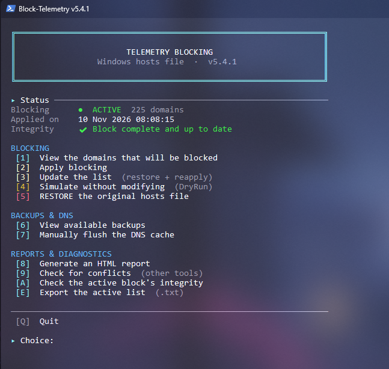
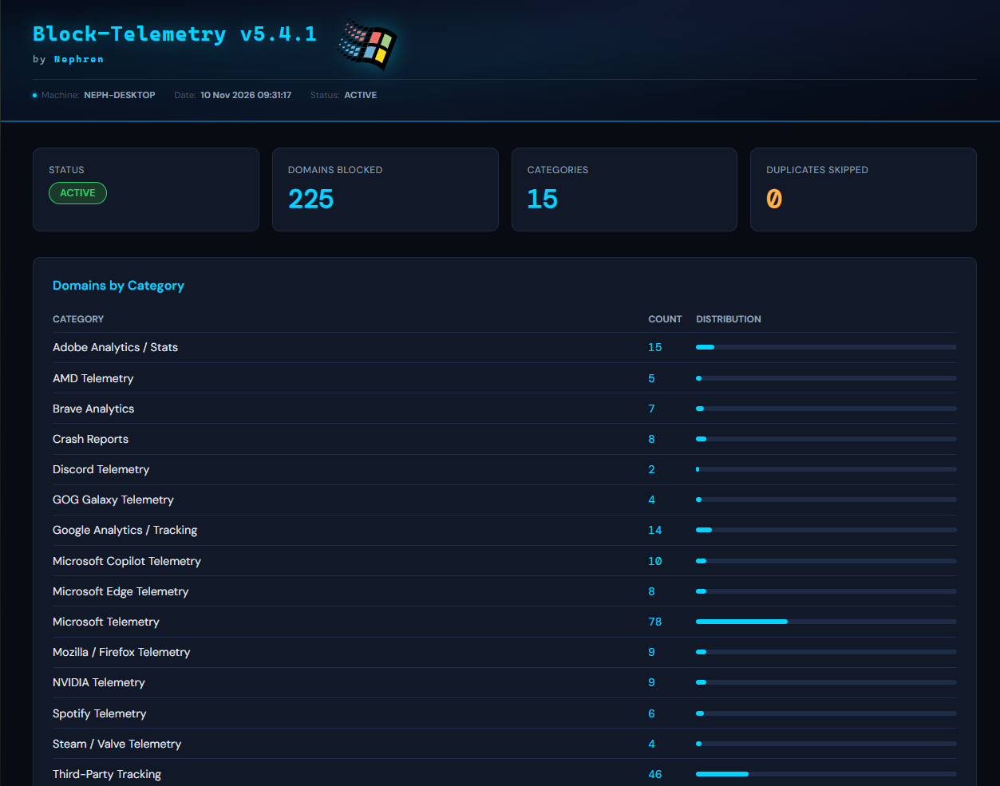
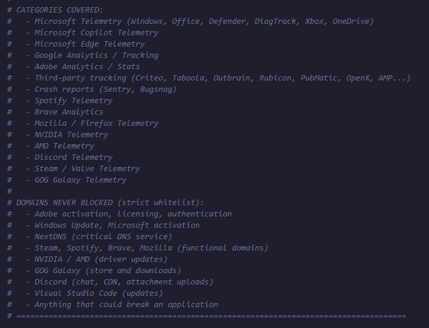

# Block-Telemetry

🇬🇧 [English version](README.md)

Script PowerShell autonome qui bloque les domaines de télémétrie, d'analytics et de tracking tiers sur Windows via le fichier `hosts` — avec sauvegardes automatiques, liste blanche stricte, simulation avant application, restauration en un clic, et vérificateur d'intégrité pour que le blocage ne dérive jamais silencieusement.

> Rien n'est laissé au hasard. Une liste blanche stricte protège les domaines d'activation/licence/mise à jour par correspondance exacte (jamais une correspondance de sous-chaîne), chaque modification réelle est sauvegardée avant écriture, et le blocage actif peut être vérifié par rapport à la liste attendue à tout moment.

---

## Captures d'écran

<table>
<tr>
<td></td>
<td></td>
</tr>
</table>

Plus de captures (vérification d'intégrité, liste des sauvegardes, rapport HTML complet) dans le dossier [`screenshots/`](screenshots).

---

## Sommaire

- [Captures d'écran](#captures-décran)
- [Présentation](#présentation)
- [Fonctionnement](#fonctionnement)
- [Ce qui est bloqué](#ce-qui-est-bloqué)
- [Ce qui n'est jamais bloqué (liste blanche)](#ce-qui-nest-jamais-bloqué-liste-blanche)
- [Protection cloud de Windows Defender](#protection-cloud-de-windows-defender)
- [Garanties de sécurité](#garanties-de-sécurité)
- [Prérequis](#prérequis)
- [Premier lancement](#premier-lancement-pas-à-pas)
- [Référence du menu](#référence-du-menu)
- [Paramètres en ligne de commande](#paramètres-en-ligne-de-commande)
- [Fichiers écrits par le script](#fichiers-écrits-par-le-script)
- [Déploiement multi-machines](#déploiement-multi-machines)
- [Dépannage](#dépannage)

---

## Présentation

`Block-Telemetry.ps1` modifie **un seul fichier** : le fichier `hosts` de Windows (`C:\Windows\System32\drivers\etc\hosts`). Il ajoute un bloc clairement delimite d'entrées `0.0.0.0 <domaine>` pour des domaines connus de télémétrie, d'analytics et de tracking, de sorte que la résolution DNS de ces domaines échoue localement — aucun trafic ne les atteint.

Il ne touche **pas** au registre, n'arrête aucun service Windows, n'installe rien, et ne modifie aucun autre fichier que `hosts` (à l'exception de ses propres sauvegardes/logs/rapports dans un dossier `Maintenance_Reports\Block-Telemetry` sur le Bureau).

Le script fonctionne comme un **menu interactif** — il n'existe pas de commande "nettoyer en un coup" en ligne de commande pour l'action de blocage elle-même (seul `-SelfTest` est un vrai paramètre CLI). C'est voulu : modifier `hosts` est une modification durable (contrairement à un nettoyage ponctuel), donc le script garde un humain dans la boucle pour appliquer, mettre à jour et restaurer.

> **Note :** depuis la v5.3, l'interface du script (console, menu interactif, rapport HTML) est entièrement en anglais. Ce README reste en français, mais tout ce que vous verrez à l'écran en lançant le script sera en anglais.

---

## Fonctionnement

1. Toutes les modifications vivent dans un seul bloc clairement delimite dans `hosts` :

   ```
   # === TELEMETRY BLOCK - Do not modify manually ===
   # Generated on 18 Aug 2026 10:00:00
   # To restore: rerun this script and choose option 5
   #
   # -- Microsoft Telemetry --
   0.0.0.0 vortex.data.microsoft.com
   0.0.0.0 telecommand.telemetry.microsoft.com
   ...
   # === END TELEMETRY BLOCK ===
   ```

   *(Depuis la v5.3, le bloc et tout le texte affiché par le script — console et rapport HTML — sont entièrement en anglais ; seule cette documentation reste en français.)*

   Tout ce qui se trouve en dehors de ces deux marqueurs reste totalement intact — vos propres entrées manuelles dans `hosts`, les entrées d'autres outils, tout.

2. Avant **toute** écriture dans `hosts`, une sauvegarde horodatée est créée dans le sous-dossier `Hosts_Backups` (voir [Fichiers écrits par le script](#fichiers-écrits-par-le-script)). Si la sauvegarde échoue, le script refuse de modifier `hosts`.

3. Les domaines déjà présents n'importe où dans votre fichier `hosts` (ajoutés manuellement ou par un autre outil) sont détectés et ignorés plutôt que dupliqués.

4. La restauration supprime **uniquement** le contenu entre les deux marqueurs — votre fichier `hosts` original (et tout ce qui a été ajouté depuis en dehors du bloc) est préservé exactement tel quel.

---

## Ce qui est bloqué

15 catégories, **225 domaines** au total :



<details>
<summary><strong>Microsoft Télémétrie</strong> — 78 domaines</summary>

Données de diagnostic Windows (pipelines DiagTrack / vortex / watson), pipeline de télémétrie Office/ARIA, anciens noms MAPS/« SpyNet » de Defender (`spynet*`, laissés bloqués mais non vérifiés — voir les commentaires du script), point de terminaison Windows Live/OneDrive `ssw.live.com`, points de collecte publicitaires/suggestions MSN/Cortana/Bing, télémétrie Xbox/Game Bar, télémétrie OneDrive (pas la synchronisation), télémétrie Teams (pas la communication).

*Exclus volontairement :* `windowsupdate.com`, `update.microsoft.com`, `msftconnecttest.com` (nécessaires aux mises à jour et à la détection de connectivité), ainsi que `wdcp.microsoft.com` / `wdcpalt.microsoft.com` (protection fournie par le cloud de Microsoft Defender — voir [Protection cloud de Windows Defender](#protection-cloud-de-windows-defender)).
</details>

<details>
<summary><strong>Microsoft Copilot Télémétrie</strong> — 10 domaines</summary>

Données d'usage, requêtes et contexte envoyés vers les serveurs Microsoft/Bing. Copilot lui-même n'est pas bloqué fonctionnellement sur les machines qui l'utilisent — seuls les points de collecte analytiques le sont.
</details>

<details>
<summary><strong>Microsoft Edge Télémétrie</strong> — 8 domaines</summary>

Utile même si Edge est désinstallé — WebView2 et les résidus d'Edge peuvent encore contacter ces points de collecte.
</details>

<details>
<summary><strong>Google Analytics / Tracking</strong> — 14 domaines</summary>

Google Analytics, Tag Manager, DoubleClick, Google Ad Services.

*Exclus volontairement :* `google.com`, `googleapis.com`, `gstatic.com` (nécessaires à de nombreuses applications web et flux d'authentification).
</details>

<details>
<summary><strong>Adobe Analytics / Stats</strong> — 15 domaines</summary>

Adobe Analytics/Omniture, Adobe Audience Manager, Adobe Dynamic Tag Manager, Adobe Marketing/Advertising Cloud.

*Exclus volontairement :* `adobe.com`, `adobelogin.com`, `adobegenuine.com`, `lcs-cops.adobe.com` (activation, licences, points fonctionnels).
</details>

<details>
<summary><strong>Tracking tiers</strong> — 46 domaines</summary>

Aucun de ces domaines n'appartient à une application installée localement — ils ne sont chargés que par des sites web ou des applications pour vous pister d'une session à l'autre : ScorecardResearch, Quantcast, Chartbeat, tracking Facebook/Meta, Amazon Ads, Twitter/X Ads, Hotjar, Mixpanel, Segment, Criteo, Taboola, Outbrain, Rubicon/Magnite, PubMatic, OpenX, Moat, Google AMP, LinkedIn Insight Tag.
</details>

<details>
<summary><strong>Rapports de crash</strong> — 8 domaines</summary>

Sentry.io, Bugsnag — envoient les stack traces et données système lors de plantages d'applications. Informatif mais intrusif ; à noter que cela peut réduire la qualité des correctifs des applications puisque les développeurs perdent ces données de diagnostic.
</details>

<details>
<summary><strong>Spotify Télémétrie</strong> — 6 domaines</summary>

*Exclus volontairement :* `*.spotify.com` (streaming, connexion, API), `*.scdn.co` (CDN musique), `accounts.spotify.com`, `api.spotify.com`.
</details>

<details>
<summary><strong>Brave Analytics</strong> — 7 domaines</summary>
</details>

<details>
<summary><strong>Mozilla / Firefox Télémétrie</strong> — 9 domaines</summary>
</details>

<details>
<summary><strong>NVIDIA Télémétrie</strong> — 9 domaines</summary>
</details>

<details>
<summary><strong>AMD Télémétrie</strong> — 5 domaines</summary>
</details>

<details>
<summary><strong>Discord Télémétrie</strong> — 2 domaines</summary>
</details>

<details>
<summary><strong>Steam / Valve Télémétrie</strong> — 4 domaines</summary>
</details>

<details>
<summary><strong>GOG Galaxy Télémétrie</strong> — 4 domaines</summary>
</details>

Utiliser l'option de menu **[1]** à tout moment pour afficher la liste complète et actuelle groupee par catégorie, ou **[E]** pour l'exporter vers un fichier texte.

---

## Ce qui n'est jamais bloqué (liste blanche)

**74 domaines** sont codes en dur dans une liste blanche absolue, vérifiée par **correspondance exacte uniquement** (jamais une correspondance de sous-domaine/sous-chaîne — voir la section SelfTest) — même si l'un d'eux se retrouvait par erreur dans la liste de télémétrie, il ne serait jamais écrit dans `hosts` :

- Activation, licences, enregistrement Adobe (`activate.adobe.com`, `genuine.adobe.com`, `lcs-cops.adobe.com`...)
- Windows Update, activation, connexion Microsoft (`update.microsoft.com`, `login.microsoftonline.com`, `msftconnecttest.com`...)
- Protection fournie par le cloud de Microsoft Defender (`wdcp.microsoft.com`, `wdcpalt.microsoft.com`)
- Synchronisation OneDrive, authentification Xbox Live, communication Teams
- NextDNS (service DNS critique)
- Streaming/authentification/API Spotify, CDN `scdn.co`
- Points de mise à jour et de navigation sécurisée Brave et Mozilla/Firefox
- Plateforme Steam et anti-cheat, mises à jour pilotes NVIDIA/AMD
- Discord (chat, CDN et envoi de pièces jointes — `discord-attachments-uploads-prd.storage.googleapis.com`), GOG Galaxy, mises à jour Visual Studio Code
- Epic Games (garde en liste blanche par précaution à coût nul, même si non utilise activement, pour éviter un blocage accidentel si la liste est réutilisée ou étendue sur une autre machine plus tard)

---

## Protection cloud de Windows Defender

### Pourquoi `wdcp.microsoft.com` et `wdcpalt.microsoft.com` ne sont jamais bloqués

Ces deux noms d'hôte sont les points de terminaison de la **protection fournie par le cloud** de Microsoft Defender Antivirus, aussi appelée **MAPS** (*Microsoft Active Protection Service*, anciennement *SpyNet*). Microsoft les cite comme tels dans sa documentation de connectivité de Defender.

Les versions antérieures à la v5.4.1 les bloquaient comme « télémétrie ». C'était une erreur : renvoyés vers `0.0.0.0`, Defender ne peut plus joindre son service cloud, et rien à l'écran ne le signale. La documentation de Microsoft indique que bloquer `wdcp.microsoft.com` revient à ce que l'appareil n'utilise plus la protection basée sur le cloud. Depuis la v5.4.1, les deux domaines sont en liste blanche, ne peuvent plus être ajoutés à la liste de blocage, et `-SelfTest` échoue si cela arrive.

### À quoi sert la protection cloud, et pourquoi il vaut mieux la garder active

La protection **locale** de Defender (signatures, analyse en temps réel, surveillance comportementale) continue de fonctionner sans le cloud. La protection cloud ajoute une couche pour ce qui est **nouveau ou inconnu** :

- Quand un fichier ou un comportement paraît suspect sans figurer dans les signatures locales, Defender envoie des **métadonnées** à Microsoft et obtient un verdict en quelques secondes — souvent avant qu'une signature existe pour cette menace.
- Associée à l'envoi automatique d'échantillons, elle active **Block at First Sight**, la fonction que Microsoft décrit comme détectant et bloquant un nouveau malware en quelques secondes.
- Les mises à jour de signatures arrivent par Windows Update, pas par ces deux domaines. Un Defender « à jour » reste donc exposé pendant le délai entre l'apparition d'une menace et la publication de sa signature — exactement l'intervalle que couvre le cloud.

Ce script vise à réduire la télémétrie **sans affaiblir la sécurité** : il laisse donc la protection cloud tranquille. Pour la plupart des utilisateurs, la confidentialité gagnée en la coupant est faible comparée à la protection perdue. Pour limiter malgré tout les données envoyées à Microsoft, le faire dans les réglages de Defender (voir [Réduire la télémétrie de Defender](#réduire-la-télémétrie-de-defender)) plutôt que dans `hosts` : une entrée hosts ne bloque que les noms exacts qu'elle liste, alors que Microsoft documente des domaines génériques (jokers) pour ce service.

> Ce script ne modifie aucun réglage de Defender. Après un « Appliquer » réel, il se contente de *lire* les exclusions de Defender pour afficher un message d'information.

### Vérifier sa protection Defender

Ouvrir PowerShell **en administrateur** (certaines valeurs sont masquées sinon) et lancer :

```powershell
Get-MpPreference | Select-Object MAPSReporting, SubmitSamplesConsent, CloudBlockLevel, CloudExtendedTimeout, PUAProtection, DisableRealtimeMonitoring | Format-List
```

Lecture du résultat :

| Réglage | Valeur | Signification |
|---|---|---|
| `MAPSReporting` | `0` | Protection cloud **désactivée** |
| | `1` | Adhésion de base (informations de base sur les logiciels détectés) |
| | `2` | Adhésion avancée (plus d'informations : emplacement, noms de fichiers, comportement) |
| `SubmitSamplesConsent` | `0` | Toujours demander avant d'envoyer un échantillon |
| | `1` | Envoyer automatiquement les échantillons « sûrs » (sans données personnelles) ; demander sinon |
| | `2` | **Ne jamais** envoyer d'échantillons — désactive aussi Block at First Sight |
| | `3` | Envoyer tous les échantillons automatiquement |
| `CloudBlockLevel` | `0` | Par défaut |
| | `2` / `4` | Élevé / Élevé+ (blocage plus agressif selon les verdicts cloud) |
| | `6` | Tolérance zéro — bloque les programmes inconnus, y compris des logiciels légitimes |
| `CloudExtendedTimeout` | `0`–`50` | Secondes supplémentaires pendant lesquelles Defender peut retenir un fichier suspect en attendant le verdict cloud (nécessite Block at First Sight) |
| `PUAProtection` | `0` / `1` / `2` | Désactivée / **Activée** (bloque les applications potentiellement indésirables) / Mode audit |
| `DisableRealtimeMonitoring` | `False` | Protection en temps réel **active** (c'est ce qu'il faut) |

Une configuration saine ressemble à : `MAPSReporting` 1 ou 2, `SubmitSamplesConsent` 1, `PUAProtection` 1, `DisableRealtimeMonitoring` False. `CloudBlockLevel` et `CloudExtendedTimeout` relèvent du durcissement optionnel.

Deux autres vérifications utiles :

```powershell
# Protection contre les falsifications, temps réel, date de la dernière mise à jour des signatures
Get-MpComputerStatus | Select-Object IsTamperProtected, RealTimeProtectionEnabled, AntivirusSignatureLastUpdated | Format-List

# Defender peut-il réellement joindre son service cloud ? (PowerShell administrateur)
& "$env:ProgramFiles\Windows Defender\MpCmdRun.exe" -ValidateMapsConnection
```

La dernière commande doit se terminer par *« successfully established a connection to MAPS »*. Si elle échoue avec `0x80070005`, PowerShell n'est pas lancé en administrateur. Si elle échoue avec une autre erreur, vérifier que `Resolve-DnsName wdcp.microsoft.com` ne renvoie **pas** `0.0.0.0` (sinon quelque chose dans `hosts` le bloque encore — lancer l'option `[3]` Mettre à jour de ce script, qui n'écrit plus ces deux lignes). Si `MpCmdRun.exe` est introuvable, regarder dans `C:\ProgramData\Microsoft\Windows Defender\Platform\<version>\`.

### Réduire la télémétrie de Defender

Chaque étape ci-dessous coûte un peu de protection : à choisir en connaissance de cause. Toutes les commandes nécessitent un PowerShell administrateur. Si `IsTamperProtected` vaut `True`, Windows peut refuser ces modifications : désactiver temporairement la Protection contre les falsifications dans *Sécurité Windows → Protection contre les virus et menaces → Paramètres de protection contre les virus et menaces*, puis la réactiver.

| Objectif | Commande | Ce qui est perdu |
|---|---|---|
| Envoyer moins d'informations (garder le cloud) | `Set-MpPreference -MAPSReporting 1` | Moins de détails envoyés à Microsoft ; l'efficacité complète de Block at First Sight en mode de base n'est pas documentée (les instructions de Microsoft pour cette fonction utilisent le mode avancé) |
| Ne jamais envoyer de fichiers | `Set-MpPreference -SubmitSamplesConsent 2` | **Block at First Sight est désactivé** ; les fichiers inconnus sont jugés sur leurs métadonnées seules. Les métadonnées restent envoyées lors d'une détection |
| Aucun cloud | `Set-MpPreference -MAPSReporting 0` | Plus de verdicts cloud, plus de Block at First Sight — **déconseillé** |

Pour revenir aux valeurs recommandées : `Set-MpPreference -MAPSReporting 2 -SubmitSamplesConsent 1`.

### Renforcer Defender

```powershell
Set-MpPreference -MAPSReporting 2 -SubmitSamplesConsent 1 -CloudBlockLevel 4 -CloudExtendedTimeout 50 -PUAProtection 1 -DisableBlockAtFirstSeen $false
```

- `-CloudBlockLevel 4` (Élevé+) bloque plus agressivement selon les verdicts cloud ; le niveau `6` (tolérance zéro) est déconseillé au quotidien car il peut bloquer des programmes légitimes jamais exécutés auparavant.
- `-CloudExtendedTimeout 50` laisse Defender attendre jusqu'à 50 secondes supplémentaires un verdict sur un fichier suspect : meilleure détection, mais le premier lancement d'un programme inconnu peut être plus long.
- Vérifier aussi dans *Sécurité Windows → Protection contre les virus et menaces → Paramètres* que **Protection en temps réel**, **Protection fournie par le cloud**, **Envoi automatique d'échantillons** et **Protection contre les falsifications** sont activés, et laisser Windows Update fonctionner.

Le comportement et les valeurs par défaut de Defender sont définis par Microsoft et peuvent changer selon les versions de Windows ; voir la documentation Microsoft sur *cloud protection and sample submission* et *block at first sight*.

---

## Garanties de sécurité

| # | Garantie |
|---|---|
| S1 | Sauvegarde automatique du fichier hosts avant toute modification |
| S2 | Liste blanche stricte — aucun domaine fonctionnel n'est jamais bloqué |
| S3 | Rotation automatique des sauvegardes (conservation des 10 dernières) |
| S4 | Mode simulation (DryRun depuis le menu) pour prévisualiser sans rien toucher |
| S5 | Fonction de restauration complète intégrée (un seul choix au menu) |
| S6 | Marqueur unique dans le fichier hosts pour identifier exactement ce que ce script a ajouté |
| S7 | Aucune modification de registre, aucun service arrêté, aucun pilote touché |
| S8 | Option "Mettre à jour" intégrée (restaure + re-applique en une étape) |
| S9 | Encodage UTF-8 **avec BOM** garanti — indispensable pour que PowerShell 5.1 détecte correctement l'UTF-8 (PowerShell 7 gère les deux cas, avec ou sans BOM) |
| S10 | Vérification des doublons avant écriture (domaines déjà présents ignorés) |
| S11 | Détection de conflits avec d'autres outils modifiant hosts (CTT WinUtil, StevenBlack hosts, HostsMan, Spybot Anti-Beacon, MVPS Hosts...) |
| S12 | Vérification d'intégrité du bloc actif (domaines attendus vs domaines réellement présents) |
| S13 | Nettoyage optionnel des entrées externes (hors du bloc propre à ce script) |

---

## Prérequis

- Windows 10 ou 11.
- PowerShell 5.1 (intégré à Windows) ou PowerShell 7+.
- Droits administrateur. Le script s'auto-élève si lancé depuis une session non-admin (fenêtre UAC) — sauf pour `-SelfTest`, qui fonctionne en lecture seule et **ne nécessite pas** d'élévation.
- Accès en écriture à `C:\Windows\System32\drivers\etc\hosts` (standard sur toute session admin).
- Recommandé : **Windows Terminal** (par défaut sur Windows 11) pour le meilleur rendu de l'interface console (caractères de cadre et icônes de statut). La fenêtre console classique fonctionne aussi, mais certaines icônes dépendent de la police choisie.
- Si le script est signé numériquement (recommandé en environnement `-ExecutionPolicy AllSigned`/`RemoteSigned`) : le certificat de signature doit être approuvé sur la machine cible, sans quoi PowerShell refusera l'exécution.

---

## Premier lancement (pas à pas)

1. Copier `Block-Telemetry.ps1` sur la machine cible.

2. Ouvrir un terminal PowerShell (pas besoin de le lancer en admin à la main — le script s'auto-élève, sauf pour l'étape 4 ci-dessous).

   Puis se placer dans le dossier qui contient le script (adapter le chemin ; garder les guillemets s'il contient des espaces) :

   ```powershell
   cd "$HOME\Downloads"
   ```

3. **Débloquer le script** s'il a été téléchargé depuis Internet. Windows marque les fichiers téléchargés, et la politique d'exécution de PowerShell (`RemoteSigned`, par exemple) refuse de lancer un script marqué. Depuis le dossier du script :

   ```powershell
   Unblock-File .\Block-Telemetry.ps1
   ```

   Si PowerShell indique plutôt que l'exécution de scripts est désactivée sur ce système (la politique par défaut de Windows est `Restricted`), autoriser d'abord les scripts pour le compte courant (la modification ne s'applique qu'à ce compte, pas à toute la machine) :

   ```powershell
   Set-ExecutionPolicy -Scope CurrentUser -ExecutionPolicy RemoteSigned
   ```

   Toujours bloqué ? Voir le [guide pas à pas](https://github.com/NephVx2/Script-blocked-Look-at-this/blob/main/README_POWERSHELL_FRENCH.md).

4. Lancer d'abord le self-test logique — il est en lecture seule, ne nécessite **pas** de droits admin, et ne touche pas à `hosts` :

   ```powershell
   .\Block-Telemetry.ps1 -SelfTest
   ```

   Exécute 10 vérifications : la liste blanche n'a pas de doublons internes, aucun domaine n'est à la fois bloqué et en liste blanche, la correspondance de la liste blanche est exacte (pas par sous-domaine), `Get-DomainsToBlock` retourne une liste non vide, la liste de domaines se construit sans doublon, les deux marqueurs sont distincts, `Get-IntegrityStatus`/`Test-IsAlreadyBlocked` s'exécutent sans lever d'exception, et aucun domaine bloqué ne se trouve sur un suffixe d'hébergement cloud partagé (`*.storage.googleapis.com`, `*.amazonaws.com`, `*.blob.core.windows.net`, `*.azureedge.net`...) sans avoir été vérifié à la main, et les points de terminaison de la protection cloud Defender (`wdcp` / `wdcpalt`) sont en liste blanche et non bloqués. Le script quitte ensuite sans avoir touché à aucun fichier.

5. Lancer le script normalement (il demandera l'élévation) :

   ```powershell
   .\Block-Telemetry.ps1
   ```

6. Depuis le menu, prévisualiser ce qui se passerait **sans rien changer** :

   ```
   [4] Simulate without modifying (DryRun)
   ```

   Affiche chaque domaine qui serait ajouté et chaque doublon qui serait ignoré, exactement comme le ferait l'option [2] pour de vrai, mais n'écrit rien.

7. Optionnel : revoir la liste complète des domaines et l'aperçu de la liste blanche :

   ```
   [1] View the domains that will be blocked
   ```

8. Appliquer le blocage pour de vrai :

   ```
   [2] Apply blocking
   ```

   Crée une sauvegarde, écrit le bloc dans `hosts`, vide le cache DNS, et écrit un instantané JSON de l'action.

9. Confirmer que ça fonctionne : vérifier l'option **[A]** (intégrité) à tout moment ensuite, ou depuis un autre terminal :

   ```powershell
   Resolve-DnsName vortex-win.data.microsoft.com
   ```

   devrait échouer à résoudre (ou résoudre vers `0.0.0.0`) une fois le blocage actif et le cache DNS vidé.

10. Pour tout annuler, utiliser l'option **[5]** — supprime uniquement le bloc de ce script, en sauvegardant l'état actuel avant, et laisse le reste de votre fichier `hosts` intact.

---

## Référence du menu

| Option | Action |
|---|---|
| `[1]` | Afficher la liste complète des domaines qui seraient bloqués, groupes par catégorie (avec le nombre de domaines par catégorie), plus un aperçu de la liste blanche |
| `[2]` | Appliquer le blocage pour de vrai (sauvegarde → écriture → vidage DNS → instantané JSON). Si un blocage est déjà actif, propose une mise à jour à la place |
| `[3]` | Mettre à jour la liste (restaure, puis re-applique) — à utiliser après avoir récupéré une version plus récente du script avec des domaines supplémentaires |
| `[4]` | Simulation : simule l'option [2] sans rien écrire |
| `[5]` | **Restaurer** — supprime uniquement le bloc de ce script, contenu original de hosts préservé |
| `[6]` | Lister les sauvegardes disponibles (horodatage, nom de fichier, taille) avec instructions de restauration manuelle |
| `[7]` | Vider le cache DNS manuellement (`ipconfig /flushdns`) |
| `[8]` | Générer un rapport HTML |
| `[9]` | Détecter les conflits avec d'autres outils modifiant hosts, et nettoyer optionnellement les entrées hors du bloc propre à ce script |
| `[A]` | Vérifier l'intégrité du bloc actif (domaines attendus vs domaines réellement présents — signale tout élément manquant ou en trop) |
| `[E]` | Exporter la liste de domaines active vers un fichier `.txt` dans `Maintenance_Reports\Block-Telemetry` sur le Bureau |
| `[Q]` | Quitter |

Le menu est organisé en trois groupes — **Blocking**, **Backups & DNS** et **Reports & diagnostics** — sous un panneau **Status** qui affiche toujours, en un coup d'œil : si un blocage est actif, combien de domaines, quand il a été appliqué, et un indicateur d'intégrité compact (réutilisant la même vérification que l'option `[A]`) pour que toute dérive soit visible sans avoir à fouiller dans le menu.

Tous les écrans partagent le même langage visuel : bandeaux encadrés, titres de section `▸`, et icônes de statut (`✔` succès, `✘` erreur, `▲` avertissement, `●` info, `○` ignoré, `◆` simulation). Apply et Restore se terminent par une boîte de résultat encadrée.

---

## Paramètres en ligne de commande

| Paramètre | Description |
|---|---|
| `-SelfTest` | Exécute les 10 vérifications logiques en lecture seule décrites dans [Premier lancement](#premier-lancement-pas-à-pas) puis quitte. Aucun droit admin requis, aucun fichier touché. |

Toutes les autres actions (appliquer, mettre à jour, simuler, restaurer, rapports, exports) passent par le menu — il n'existe volontairement pas de paramètres CLI équivalents, puisqu'il s'agit de modifications durables d'un fichier système plutôt que de tâches de maintenance ponctuelles.

---

## Fichiers écrits par le script

| Fichier / dossier | Contenu |
|---|---|
| `%SystemRoot%\System32\drivers\etc\hosts` | Le seul fichier réellement modifié — entrées de blocage ajoutées dans le bloc marqué |
| `%USERPROFILE%\Desktop\Maintenance_Reports\Block-Telemetry\Hosts_Backups\hosts_backup_<horodatage>` | Copie complète de hosts prise avant chaque écriture réelle (rotation automatique, 10 dernières conservées) |
| `%USERPROFILE%\Desktop\Maintenance_Reports\Block-Telemetry\Block-Telemetry_Log.txt` | Journal d'actions en texte brut (ajout uniquement) |
| `%USERPROFILE%\Desktop\Maintenance_Reports\Block-Telemetry\Block-Telemetry_<horodatage>.json` | Instantané JSON écrit après chaque action réelle (Apply / Update / Restore) — type d'action, nombre de domaines, répartition par catégorie |
| `%USERPROFILE%\Desktop\Maintenance_Reports\Block-Telemetry\Block-Telemetry_Export_<horodatage>.txt` | Créé uniquement via l'option de menu `[E]` — export texte de la liste de domaines active |
| `%USERPROFILE%\Desktop\Maintenance_Reports\Block-Telemetry\Block-Telemetry_<horodatage>.html` | Rapport HTML — créé uniquement via l'option de menu `[8]`, généré à la demande |

Rien n'est écrit en dehors de ces emplacements. `-DryRun` (option de menu `[4]`) et `-SelfTest` n'écrivent **aucun** fichier — pas de sauvegarde, pas de log, pas d'instantané JSON.

---

## Déploiement multi-machines

Le script est autonome (aucune dépendance externe). Pour un déploiement multi-machines :

1. **Distribuer** le fichier `.ps1` vers chaque machine cible.

2. **Approuver le certificat de signature** si une politique d'exécution stricte est en place (`-ExecutionPolicy AllSigned`/`RemoteSigned`), sans quoi PowerShell refuse l'exécution.

3. **Exécuter `-SelfTest` en premier** sur chaque machine — il ne nécessite aucun droit admin et ne touche à rien, donc il est sans risque à lancer avant de décider de la suite.

4. Comme ce script est **interactif par conception** (pilote par menu, pas de paramètre CLI pour appliquer le blocage), il n'est **pas** un candidat direct pour une tâche planifiée silencieuse comme le serait un script de nettoyage. Pour un déploiement multi-machines non supervisé, envisager soit :
   - de le lancer une fois de manière interactive par machine lors du provisionnement/de l'imagerie, soit
   - d'extraire la liste de domaines (`$TelemetryDomains` / `$AbsoluteWhitelist`) dans un script non-interactif séparé adapté à votre pipeline de déploiement si un rollout entièrement silencieux est nécessaire.

5. Les sauvegardes, logs et instantanés JSON sont écrits dans le profil de l'utilisateur qui exécute le script — propres à chaque machine, non centralisés automatiquement.

---

## Dépannage

<details>
<summary><strong>Un site ou une application a cessé de fonctionner après l'application du blocage</strong></summary>

Vérifier d'abord l'option `[9]` (détection de conflits) pour écarter qu'un autre outil ait modifié `hosts`. Si le problème vient réellement de ce script, la solution la plus sûre est l'option `[5]` (Restaurer) pour annuler complètement le blocage, puis signaler quel domaine semble poser problème — les domaines fonctionnels légitimes devraient déjà être en liste blanche, donc cela pointerait vers un domaine à y ajouter.
</details>

<details>
<summary><strong>Discord n'envoie plus de fichiers ni d'images (le chat fonctionne toujours)</strong></summary>

Corrigé en v5.3.1. Les versions précédentes bloquaient `discord-attachments-uploads-prd.storage.googleapis.com` comme « télémétrie », alors que c'est le bucket de stockage vers lequel Discord envoie les pièces jointes — avec ce domaine renvoyé vers `0.0.0.0`, aucun fichier ni image personnel ne peut être envoyé, alors que les messages, `discord.com` et le CDN continuent de fonctionner. Le domaine est maintenant retiré de la liste de blocage et protégé par la liste blanche. Pour réparer une machine déjà touchée, mettre le script à jour puis lancer l'option `[3]` (Mettre à jour) afin que le bloc `hosts` soit reconstruit sans cette ligne, puis redémarrer Discord. Vérification possible avec `Resolve-DnsName discord-attachments-uploads-prd.storage.googleapis.com` — il ne doit plus renvoyer `0.0.0.0`.
</details>

<details>
<summary><strong>Windows Defender signale ou supprime le blocage dans mon fichier hosts</strong></summary>

Windows Defender considère un fichier `hosts` qui renvoie des domaines **Microsoft** vers `0.0.0.0` comme une modification potentiellement indésirable (`SettingsModifier:Win32/HostsFileHijack`). Si « Supprimer » ou « Quarantaine » est choisi, `hosts` est remis à sa valeur Windows par défaut et le blocage disparaît. C'est un comportement de Defender, pas un bug du script, et le script ne peut pas l'éviter tant qu'il bloque des domaines de télémétrie Microsoft. Le contournement documenté par Microsoft est d'exclure le fichier `hosts` des analyses, mais **une exclusion empêche aussi Defender de remarquer toute autre modification de ce fichier** (y compris par un malware) : le script ne l'ajoute donc jamais à la place de l'utilisateur, c'est sa décision. Si le fichier est exclu, lancer l'option `[A]` de temps en temps pour vérifier que le blocage est intact. Autre solution pour éviter le problème : bloquer la télémétrie au niveau DNS (NextDNS, Pi-hole, routeur) plutôt que dans `hosts`.
</details>

<details>
<summary><strong>La protection cloud de Defender ne fonctionne plus (corrigé en v5.4.1)</strong></summary>

Les versions précédentes bloquaient `wdcp.microsoft.com` et `wdcpalt.microsoft.com` comme « télémétrie », alors que ce sont les points de terminaison de la protection fournie par le cloud de Defender (MAPS). Renvoyés vers `0.0.0.0`, Defender garde sa protection locale mais perd, sans rien afficher, le verdict cloud sur les fichiers récents ou inconnus. Ils sont maintenant en liste blanche. Pour réparer une machine déjà touchée, mettre le script à jour puis lancer l'option `[3]` (Mettre à jour). Vérification dans un PowerShell **administrateur** : `Resolve-DnsName wdcp.microsoft.com` ne doit plus renvoyer `0.0.0.0`, et `& "$env:ProgramFiles\Windows Defender\MpCmdRun.exe" -ValidateMapsConnection` doit réussir.
</details>

<details>
<summary><strong>L'option [A] signale des domaines manquants ou en trop</strong></summary>

"Manquant" signifie qu'un domaine de la liste actuelle du script n'est pas présent dans le bloc actif — généralement parce que le script a été mis à jour avec de nouveaux domaines depuis la dernière application du bloc. Utiliser l'option `[3]` (Mettre à jour) pour resynchroniser. "En trop" signifie que quelque chose se trouve dans le bloc que la liste actuelle du script n'attend pas — peut venir d'une modification manuelle ou d'un décalage de version plus récente/ancienne ; l'option `[3]` résout aussi ce cas en reconstruisant le bloc depuis zero.
</details>

<details>
<summary><strong>Le blocage ne semble pas prendre effet immédiatement</strong></summary>

Le script vide automatiquement le cache DNS après chaque modification réelle (ou via l'option `[7]` manuellement), mais certaines applications mettent en cache leurs propres résolutions DNS en interne, en plus du cache du système — un redémarrage complet de l'application (voire occasionnellement de la machine) peut être nécessaire pour que le changement soit pris en compte.
</details>

<details>
<summary><strong>-SelfTest signale un FAIL</strong></summary>

Les 10 vérifications sont des contrôles de cohérence interne sur les listes de domaines/liste blanche elles-mêmes (doublons, contradictions, logique de correspondance exacte, domaines cloud partagés non vérifiés) — un FAIL ici signifie que les listes de domaines ont été modifiées d'une manière qui a introduit une incohérence, pas un problème au niveau du système. Lire le detail affiche par la vérification pour identifier le domaine ou le nombre concerne.
</details>

<details>
<summary><strong>La restauration n'a pas complètement nettoyé mon fichier hosts</strong></summary>

La restauration ne supprime que ce qui se trouve entre les marqueurs propres à ce script. Si des entrées ont été ajoutées en dehors de ce bloc (manuellement, ou par un autre outil), elles sont volontairement laissées intactes — utiliser l'option `[9]` pour détecter et nettoyer séparément, si souhaite, ces entrées externes.
</details>

<details>
<summary><strong>Certaines icônes ou caractères de cadre s'affichent en carrés ou semblent décalés</strong></summary>

L'interface console utilise des caractères Unicode (lignes de cadre et icônes de statut comme `✔ ✘ ▲ ● ○ ◆`). **Windows Terminal** les affiche correctement sans configuration. Dans la fenêtre console classique, la police choisie peut ne pas contenir certains glyphes — passer à une police comme **Cascadia Mono** ou **Consolas**, ou lancer le script depuis Windows Terminal. C'est purement cosmétique et n'affecte jamais ce que fait le script.
</details>

<details>
<summary><strong>Le script échoue au parsing sous PowerShell 5.1 ("Jeton inattendu" près d'un texte accentué)</strong></summary>

Corrigé en v5.2. Sans BOM UTF-8, PowerShell 5.1 lit le fichier `.ps1` avec l'encodage ANSI par défaut du système, ce qui corrompt les caractères accentués (é, à, le tiret cadratin —, etc.) et peut casser une chaîne en plein milieu du parsing. PowerShell 7 n'a pas ce problème car il utilise l'UTF-8 par défaut, avec ou sans BOM — d'où le fait que le script pouvait sembler "fonctionner" sous `pwsh` tout en échouant sous `powershell.exe`. Si vous avez une ancienne copie du script, retéléchargez la v5.2 ou plus récente, ou re-enregistrez le fichier vous-même en **UTF-8 avec BOM**.
</details>

---

<sub>Block-Telemetry — base sur le fichier hosts, aucune modification de registre, aucun service arrêté, rien d'installé.</sub>
